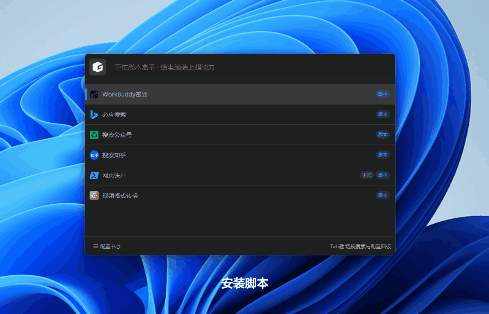

# 搜狗翻译

> 复制任意文本后双击 Ctrl+C，自动唤起默认浏览器，在搜狗翻译页面完成翻译，关键词自动带入，一步直达。

---

## 核心特性

- **复制即译**：选中文字按 `Ctrl+C+C`，无需手动粘贴，立即打开翻译页面
- **自动检测源语言**：自动识别输入语言，翻译为简体中文
- **中文兼容**：自动完成 URL 编码，中文、英文、特殊符号、换行均可
- **静默运行**：后台执行不弹终端窗口，异常情况通过桌面通知反馈

---

## 脚本演示

> ⚠️ 演示 GIF 待补录：请用 ScreenToGif / LICEcap 录制一段「复制文本 → 双击 Ctrl+C → 浏览器打开翻译页」的动图放入 `imgs/demo.gif`。

---

## 安装方法

本脚本的运行环境与触发机制依赖「不忙脚本盒子」，建议仅通过盒子安装和使用本脚本。

> 前置条件：安装好 [不忙脚本盒子](https://www.bm-box.cn)

* 打开盒子 → **脚本市场** → 搜索 **「搜狗翻译」**
* 点击「安装」

---

## 使用方式

* **超级复制（Ctrl+C+C）**
  1. 在任意应用中选中需要翻译的文字
  2. 快速双击 `Ctrl+C+C`
  3. 浏览器自动打开搜狗翻译结果页

---

## 💡 使用提示

- 剪贴板为空时，脚本会弹出桌面通知提醒先复制文本
- 当前固定为「自动检测源语言 → 简体中文」
- 首次运行请确认系统已设置默认浏览器

---

## 🖥️ 环境要求

| 项目 | 要求 |
| --- | --- |
| **操作系统** | Windows 10+ |
| **运行环境** | PowerShell 5.1+（盒子自动处理） |